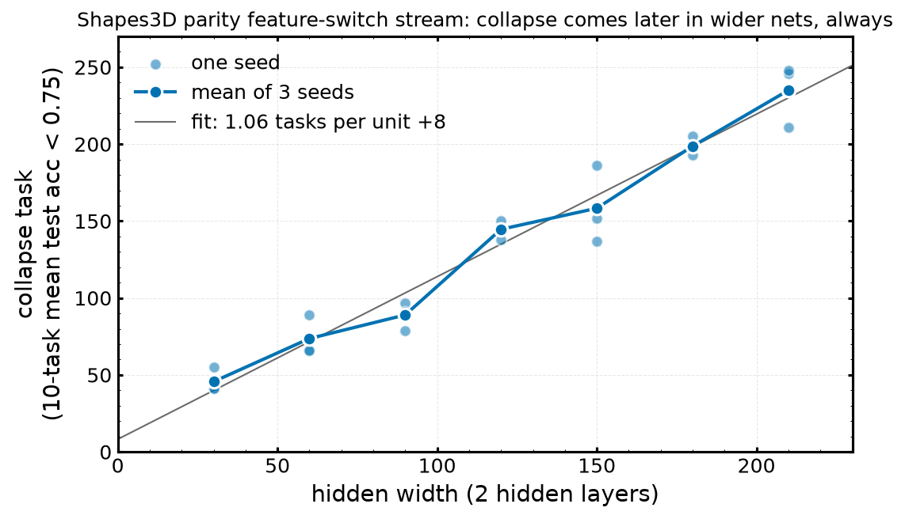
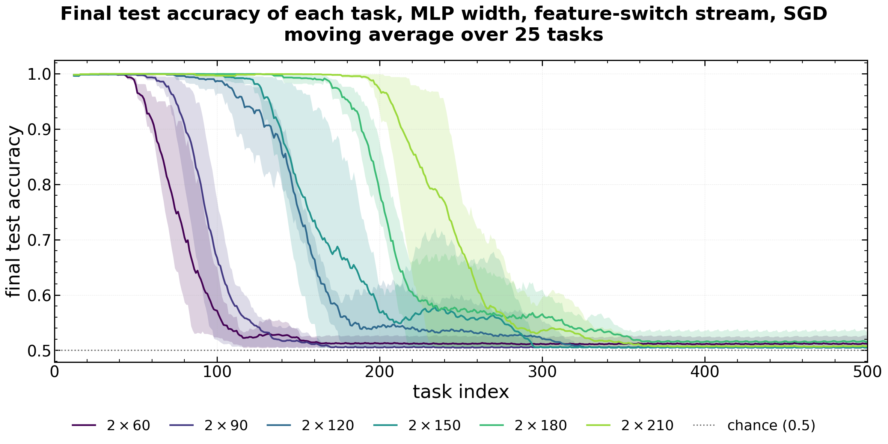
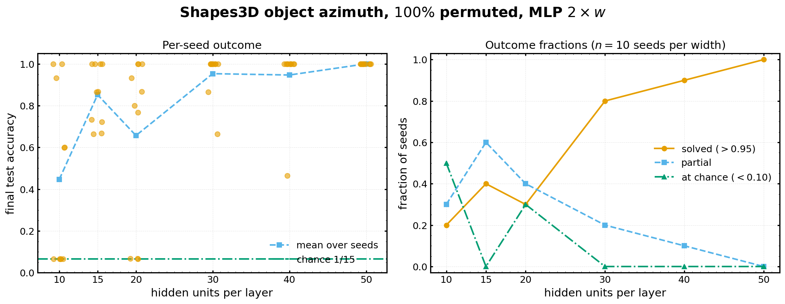
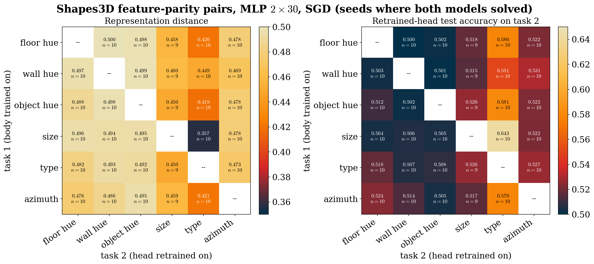

# 02 — Shapes3D feature-switch and permuted-pixel streams

Shapes3D images (64×64×3, 480k images, six generative factors: floor hue, wall hue, object hue, size, type, azimuth) labelled by the **parity** of a factor's value. In a *feature-switch* stream the factor that defines the label changes from task to task (output drift on fixed images); in a *permuted-pixel* stream the label rule stays fixed and each task applies a fresh pixel permutation (input drift). MLPs `mlp_2xW` (two hidden ReLU layers of width W), plain SGD, momentum 0, lr 0.001, batch 256, 10 epochs per task unless stated. Terms are in the [README glossary](README.md#glossary).

Numbers come from [`csv/stream_runs.csv`](csv/stream_runs.csv) / [`csv/stream_groups.csv`](csv/stream_groups.csv) (built by [`scripts/summarize_streams.py`](scripts/summarize_streams.py)), the runs' own `alive_units_*.json` / `killed_*.json` files, and prior-session notes.

Experiments in this file:

- [E1 — Parity feature-switch stream, mlp_2x30](#e1--parity-feature-switch-stream-mlp_2x30)
- [E2 — Width sweep of the feature-switch stream (60–210 units)](#e2--width-sweep-of-the-feature-switch-stream-60210-units)
- [E3 — Permuted-pixel stream, object-azimuth parity](#e3--permuted-pixel-stream-object-azimuth-parity)
- [E4 — Single-task probes: solvability, learning rate, factor-combination learnability](#e4--single-task-probes-solvability-learning-rate-factor-combination-learnability)
- [E5 — Representation distance between Shapes3D factor tasks](#e5--representation-distance-between-shapes3d-factor-tasks)

---

## E1 — Parity feature-switch stream, mlp_2x30

**Status:** complete (800 tasks, 3 seeds). **Data:** `$HPCVAULT/plasticity_results/shapes3d_stream_features_sgd/`.

### 1. Research question
When the same images are relabelled by a different factor's parity every task, does a small MLP keep learning?

### 2. Setup
mlp_2x30; 800 tasks cycling through the six factors; full 432k training images; unit health measured afterwards on the task training split (`alive_units_seed*.json`), plus gradient-reach and unit-turnover files.

### 3. Results
- Test accuracy (mean over factors of their first / last five visits): **0.984 → 0.505** (chance). The 10-task moving average falls below 0.75 at tasks **55, 41, 41** (seeds 0–2).
- **The first layer dies:** live first-layer units (of 30) at t = 0 / 100 / 400 / end: 30 / 2 / 2 / 2, 30 / 1 / 0 / 0, 30 / 0 / 0 / 0. Second-layer units left at the end: 0, 13, 8.

### 4. References
- Data: `$HPCVAULT/plasticity_results/shapes3d_stream_features_sgd/` (`alive_units_seed*.json`, `gradient_reach_n100000_seed*.json`, `unit_turnover_n100000_seed*.json`)
- Launcher: `experiments/launch_scripts/submit_stream_array.sh` (feature-switch mode); visualisation `visualization_scripts/drift_story.py`, `unit_health.py`

### 5. Conclusions
Trainability itself is lost (train and test both at chance), through first-layer death, within ~50 tasks. Centring the inputs prevents it for at least 85 tasks (file 05, E1).

### 6. Next steps proposed
- *(Proposed here)* Rerun with per-task unit health logging (`--health_every 1`, added after this run) to time first-layer death against the accuracy collapse.

---

## E2 — Width sweep of the feature-switch stream (60–210 units)

**Status:** truncated: all 18 runs died at tasks 620–641 of 800 on 2026-10-02 from a /hnvme **file-count** quota error, never resumed. **Data: only on the /hnvme workspace, which expires 2026-12-29** (`/hnvme/workspace/v170be10-plasticity_results/shapes3d_stream_features_width_sgd`, 149 GB); killed-unit counts in `$HPCVAULT/plasticity_results/shapes3d_stream_features_width_sgd_killed_units/`.

### 1. Research question
Does width prevent the collapse of E1, or only delay it?

### 2. Setup
Same stream as E1 at widths 60, 90, 120, 150, 180, 210, seeds 0–2 (job 920783, 2026-10-01/02). Collapse task = first task whose 10-task moving average of test accuracy is below 0.75.

### 3. Results
- **Every run collapses to chance** on train and test (~0.505), well before task 620, so resuming to 800 adds nothing.
- **Collapse comes ~1.06 tasks per hidden unit later** (linear fit over widths 30–210, intercept +8): mean collapse task 46 (W = 30), 74 (60), 89 (90), 145 (120), 158 (150), 199 (180), 235 (210).
- At the end the **first layer is entirely dead at every width** (0–1 live units of 60–210, seed 0) while the second layer keeps 11–150 live units.
- Reproducibility checked 2026-10-16: code at commit b995c36 reproduces the split, `init.pt` (bitwise), permutations and saved test metrics (the code that ran predates the first commit containing it).

*Made for this summary (data: [`csv/width_sweep_collapse.csv`](csv/width_sweep_collapse.csv)).*

### 4. References
- Figures: [`figures/02_width_sweep_alive_units_layer1.png`](figures/02_width_sweep_alive_units_layer1.png), [`figures/02_width_sweep_killed_units_layer1.png`](figures/02_width_sweep_killed_units_layer1.png)
- Checkpoints copied off /hnvme: mlp_2x120 seed 0 at init, task 100 (before collapse) and task 200 (after) in [`checkpoints/width_sweep/`](checkpoints/width_sweep/)
- Launcher: `submit_feature_stream_width_array.sh`; killed units `submit_killed_units_width.sh`
- Prior-session note: "project_shapes3d_width_sweep"

### 5. Conclusions
Width postpones the collapse proportionally and does not prevent it — the same conclusion the MNIST MLP streams reached in the other project (see [`cross_project_links.md`](cross_project_links.md)).

### 6. Next steps proposed
- *(Proposed here, urgent)* Archive the workspace before 2026-12-29: pack each run as a tar into `$HPCVAULT` (the vault's binding limit is its file count, 160K of 200K used) or extend the workspace (3 extensions left). The 149 GB / ~100K files cannot be copied file-by-file into the vault.

---

## E3 — Permuted-pixel stream, object-azimuth parity

**Status:** complete (800 tasks, 3 seeds). **Data:** `$HPCVAULT/plasticity_results/shapes3d_stream_perm100_sgd/`.

### 1. Research question
With a fixed label rule and a fresh pixel permutation every task (pure input drift), does the network lose plasticity, and which layer dies?

### 2. Setup
mlp_2x30, object-azimuth parity, 100% pixel permutation per task, 800 tasks; unit health, gradient reach and turnover measured afterwards.

### 3. Results
- Test accuracy 1.000 on the first tasks → **0.783** over the last five; the 10-task average crosses 0.75 at tasks **445, 515, 506**.
- **The first layer survives, the second dies:** live first-layer units stay at 22–30 throughout (end: 30, 29, 29) while second-layer units fall from 25–28 to **7, 8, 4**.

### 4. References
- Data: `$HPCVAULT/plasticity_results/shapes3d_stream_perm100_sgd/` (`alive_units_*`, `gradient_reach_*`, `unit_turnover_*`); launcher `submit_shapes3d_perm100_array.sh`

### 5. Conclusions
Input drift keeps reviving first-layer units (each new permutation moves the inputs that decide whether a unit is active), and the damage accumulates in the second layer instead. This is the same split the MNIST MLP streams show (`permuted_100` vs `permuted_classes`, other project).

### 6. Next steps proposed
- *(Proposed here)* Attribute deaths and revivals to the input change vs the optimizer from consecutive checkpoints, as the other project's `death_cause_attribution.py` does.

---

## E4 — Single-task probes: solvability, learning rate, factor-combination learnability

**Status:** complete. **Data:** `$HPCVAULT/plasticity_results/{shapes3d_perm100, sgd_lr_probe, shapes3d_pair_learnability*, shapes3d_triple_learnability*}`.

### 1. Research question
Before building streams: which Shapes3D tasks can these MLPs learn at all, at which width and learning rate?

### 2. Setup
- Azimuth (15-way, permuted pixels) at widths 10–50, 10 seeds each.
- SGD learning-rate probe, mlp_2x30, permuted pixels, five targets, lr 0.001 / 0.01 / 0.1, 2 seeds (after the switch from Adam to SGD, 2026-09-23).
- Learnability of parity over **pairs** of factors (mlp_2x70/100/200) and over **triples** (keep 2), at 10 and 20 epochs, 1 seed.

### 3. Results
- Azimuth solvability (test acc > 0.9): 3/10 seeds at width 10, 4/10 at 15 and 20, 8/10 at 30, 9/10 at 40, 10/10 at 50.
- lr 0.001 and 0.01 solve every single task (0.98–1.00); lr 0.1 fails most (floor-hue parity 0.60, azimuth 0.13–0.15) except object type (1.00).
- Factor pairs at 10 epochs: 0.49–0.60 (not learned). At 20 epochs it depends on the pair: factors 2–3 0.77–0.83, 2–5 0.57–0.87, 3–5 0.52–0.55. Triples at 20 epochs: 0.885 (2x100), **0.991** (2x150), 0.955 (2x200).

### 4. References
- [`csv/shapes3d_azimuth_width_sweep.json`](csv/shapes3d_azimuth_width_sweep.json); [`csv/stream_runs.csv`](csv/stream_runs.csv) (groups `shapes3d_*_learnability*`)
- Prior-session note: "feedback_default_optimizer_sgd" (all Shapes3D sweeps redone with SGD after an Adam run)

### 5. Conclusions
Fresh solvability depends sharply on width (azimuth) and epochs (factor combinations), so stream tasks must be checked for fresh solvability at the stream's own budget before any stream failure is called plasticity loss.

### 6. Next steps proposed
- *(Proposed here)* More than one seed for the pair/triple learnability probes before using them as stream tasks.

---

## E5 — Representation distance between Shapes3D factor tasks

**Status:** complete (SGD rerun of an Adam sweep). **Data:** `$HPCVAULT/plasticity_results/shapes3d_reprdist_*`.

### 1. Research question
Do features learned for one factor's parity help with another's? (A pairwise task distance on Shapes3D.)

### 2. Setup
`experiments/calculate_repr_distance.py`: for each ordered factor pair (6×5), train a fresh mlp_2x30 on task 1, then reset and retrain only the head on task 2 (task 1's body frozen); 10 seeds per pair. Variants for permuted pixels and for feature sets (pairs/triples), and an older Adam version (`shapes3d_reprdist_features`, `_perm100`).

### 3. Results
- Head-only transfer is at or near chance for almost every pair: mean test accuracy **0.526** over the 30 ordered pairs (range 0.500–0.643; best size → type).
- Representation distance 0.36–0.50 (mean 0.47).

### 4. References
[`csv/shapes3d_feature_pair_distance.json`](csv/shapes3d_feature_pair_distance.json); launchers `submit_repr_distance_array.sh`, `submit_feature_pairs_repr_distance_array.sh`

### 5. Conclusions
At width 30 the six Shapes3D parity tasks share almost no linearly readable features: each task switch in E1 asks for new features, which is what makes it a hard stream.

### 6. Next steps proposed
- *(Proposed here)* Repeat at width 120 to see whether feature sharing (and thus feature-reuse distance) appears with capacity, which would explain part of the width effect in E2.
