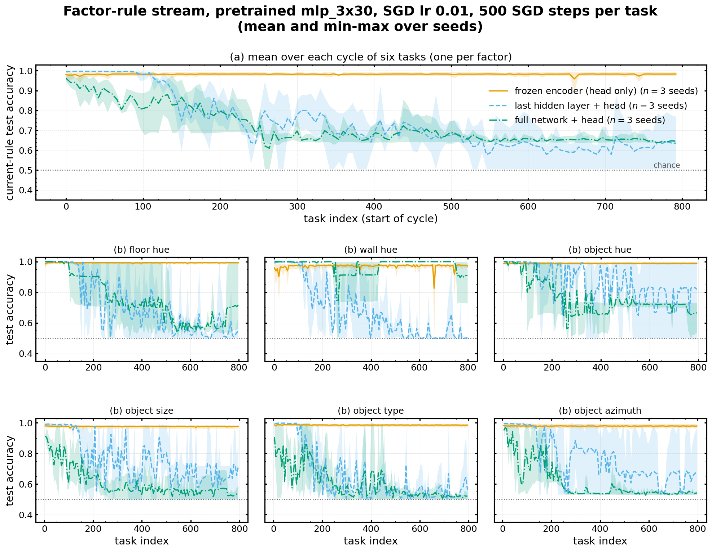
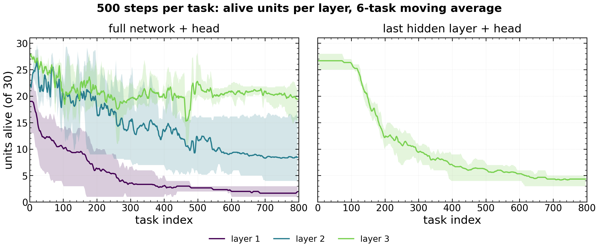

# 03 — Factor-rule stream: a frozen encoder with one persistent head ("meta-learner experiments")

**Status:** complete (800 tasks, 3 seeds, all six variants). **Data:** `$HPCVAULT/plasticity_results/shapes3d_factor_rule_stream*` (base variants) and `$WORK/plasticity_results/shapes3d_factor_rule_stream_10ep_per_task_unfreeze_{all,last}`; the three pretrained encoders are also in `plasticity/results/shapes3d_factor_rule_stream/*/checkpoints/encoder.pt` (copied to [`checkpoints/factor_rule/`](checkpoints/factor_rule/)). The user calls this line of work the "meta-learner experiments".

## 1. Research question
If the representation is fixed and good, can a single persistent linear head keep re-learning a changing decision rule for 800 tasks? And what happens when the encoder is allowed to adapt as well? This separates continual adaptation of the *rule* from continual *representation* learning.

## 2. Setup
- `experiments/run_factor_rule_stream.py`: pretrain mlp_3x30 on all six Shapes3D factors at once (six heads, summed cross-entropy; SGD lr 0.001, 10 epochs; lr ≥ 0.01 was unstable and 0.03 collapsed the encoder to ~94% dead ReLUs), freeze, cache features, fit linear probes.
- Then one persistent Linear(30, 2) head and one SGD optimizer run through 800 tasks; task t is labelled by whether factor (t mod 6) is in the upper half of its values (`binary_target`).
- Variants: frozen encoder (K = 0), last hidden layer unfrozen (K = 1), whole encoder unfrozen (K = 3); 500 steps per task or ~10 epochs (15,188 steps) per task. Plain SGD, lr 0.001.

## 3. Results
Pretrained encoder (seed 0, test accuracy of the six pretraining heads): floor / wall / object hue 0.996 / 0.994 / 0.997, object type 0.806, azimuth 0.921, object **size 0.400** (multi-class), so the representation is strong on hues and weak on size.

Current-task test accuracy, mean over factors of their first five → last five visits (3 seeds):

| encoder | 500 steps / task | ~10 epochs / task |
|---|---|---|
| frozen (K = 0) | 0.978 → **0.983** | 0.997 → **0.993** |
| last layer trainable (K = 1) | 0.996 → **0.633** | 0.999 → **0.820** |
| fully trainable (K = 3) | 0.937 → **0.644** | 0.845 → **0.505** |

- With a frozen encoder the persistent head re-learns every rule for 800 tasks with no loss.
- **Unfreezing makes it worse, and unfreezing more makes it worse still.** For K = 1 at 500 steps (seed 0), current-task accuracy falls to chance by ~task 250 while dead units in the trainable layer climb to 20 of 30; their gradients go exactly to zero.

## 4. References
- Data: the directories above; per-run metrics in [`csv/stream_runs.csv`](csv/stream_runs.csv) (`kind == "factor_rule"`); seed-0 pretraining and probe summary [`csv/factor_rule_seed0_summary.json`](csv/factor_rule_seed0_summary.json)
- Figures: [`figures/03_factor_rule_pretrain_factors.png`](figures/03_factor_rule_pretrain_factors.png), [`figures/03_factor_rule_probe_factors.png`](figures/03_factor_rule_probe_factors.png), [`figures/03_factor_rule_modes_single_500.png`](figures/03_factor_rule_modes_single_500.png), [`figures/03_factor_rule_modes_single_10ep.png`](figures/03_factor_rule_modes_single_10ep.png), [`figures/03_factor_rule_alive_units_10ep.png`](figures/03_factor_rule_alive_units_10ep.png)
- Launcher: `experiments/launch_scripts/submit_factor_rule_stream.sh` (`UNFREEZE_LAYERS`, `ENCODER_DIR`); flags `--encoder-from`, `--unfreeze-layers K`
- Prior-session notes: "project_factor_rule_stream", "project_optimizer_vs_plasticity_framing"

## 5. Conclusions
- The rule itself is easy to keep re-learning; what breaks is the trainable representation. More representational freedom gives faster collapse, through ReLU units whose gradients become exactly zero.
- The user's reading (2026-10-06): plain SGD is the culprit. Continual backprop and Fourier features work *against* the optimizer to keep plasticity; L2-to-init is the only one of the three that gives dead units a non-zero gradient, so it works *with* it. This frames follow-up work around putting plasticity into the objective or the update rule.

## 6. Next steps proposed
- *(From the notes)* Test L2-init, leaky activations and a reset-based method (CBP) on the K = 1 and K = 3 variants, where the failure is clean and fast.
- *(Proposed here)* A K = 1 run with the encoder's last layer reset to its pretrained state every N tasks, to separate "the layer drifted" from "the layer died".
