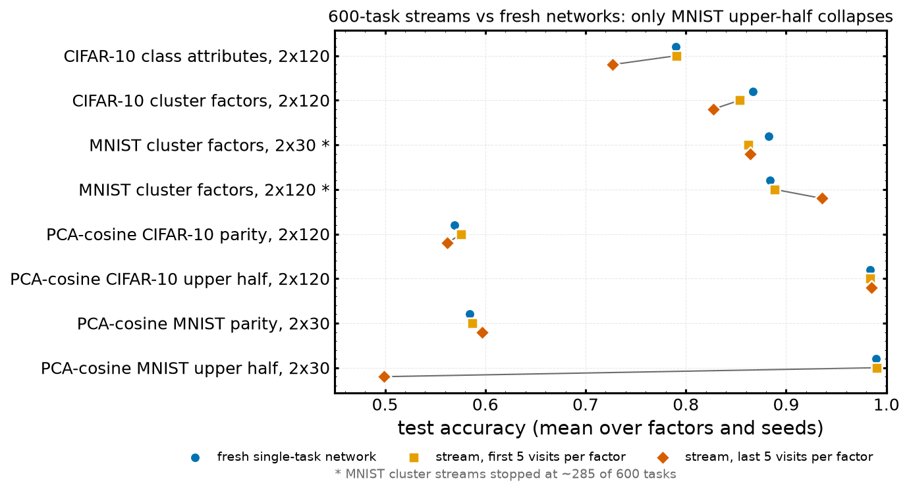

# 04 — Class-attribute, cluster-factor and PCA-factor streams on natural images

Streams of binary tasks built on CIFAR-10, MNIST and Shapes3D images, where the label changes from task to task but the images do not (output drift). Three ways of making the labels:

- **class attributes** (CIFAR-10): binary semantic attributes of the 10 classes (`animal`, `four_legs`, `fur`, `wings`, `wheels`); each attribute uses a fixed, balanced image subset, so these tasks change the input subset as well as the labels.
- **cluster factors**: six categorical "factors" from non-redundant k-means clusterings (8 clusters each) in the first 50 pixel-PCA dimensions; task label = parity of the cluster id on factor (t mod 6). On Shapes3D these are *learned* factors, not the true generative ones.
- **PCA-cosine factors**: six principal directions binned into 10 bins by cosine similarity; label = `parity` (bin parity) or `upper_half` (bin ≥ 5).

All runs: plain SGD, momentum 0, lr 0.001, batch 256, 100 epochs per task, 600 tasks, seeds 0–2, with matching **single-task baselines** (a fresh network trained on each factor alone for the same 100 epochs). Numbers from [`csv/stream_groups.csv`](csv/stream_groups.csv) and [`csv/streams_vs_fresh.csv`](csv/streams_vs_fresh.csv) (built for this summary; "first 5 / last 5" = mean test accuracy over each factor's first / last five visits, averaged over factors and seeds).

*Made for this summary from the runs' task summaries ([`scripts/make_figures.py`](scripts/make_figures.py)).*

Experiments in this file:

- [E1 — CIFAR-10 class-attribute stream, and the long-training control (G1)](#e1--cifar-10-class-attribute-stream-and-the-long-training-control-g1)
- [E2 — CIFAR-10 cluster-factor stream](#e2--cifar-10-cluster-factor-stream)
- [E3 — MNIST cluster-factor streams](#e3--mnist-cluster-factor-streams)
- [E4 — Shapes3D cluster-factor stream (the control that dies)](#e4--shapes3d-cluster-factor-stream-the-control-that-dies)
- [E5 — PCA-cosine benchmark](#e5--pca-cosine-benchmark)

---

## E1 — CIFAR-10 class-attribute stream, and the long-training control (G1)

**Status:** complete (600/600 tasks, 3 seeds). **Data:** stream `$WORK/plasticity_results/cifar10_class_stream_mlp_2x120/`; baselines `$HPCVAULT/plasticity_results/cifar10_class_single_mlp_2x120/`; G1 `$HPCVAULT/plasticity_results/g1_cifar10_animal_long_mlp_2x120/`.

### 1. Research question
Does a mlp_2x120 cycling through five semantic attributes of CIFAR-10 for 600 tasks lose the ability to learn them, and is any loss just the result of training for a very long time?

### 2. Setup
Stream as above (launched 2026-10-15 via `launch_all.sh`). **G1 control** (`launch_validation.sh`): train `animal` alone for 12,000 epochs — as long as the stream trains in total — 3 seeds.

### 3. Results
- Train accuracy reaches 1.000 on late tasks; test accuracy falls on every attribute (first 5 → last 5 visits): animal 0.853 → 0.787, four_legs 0.796 → 0.739, fur 0.759 → 0.702, wings 0.717 → 0.652, wheels 0.829 → 0.755. Mean **0.791 → 0.727**, against **0.790** for fresh single-task networks.
- **Zero dead units** in either layer through 600 tasks (measured on all 50k training images, prior-session note).
- **G1:** `animal` trained alone for 12,000 epochs reaches **0.855** test accuracy (0.851 after 100 epochs). The stream ends at 0.787 on the same attribute, so the stream's loss is not explained by the amount of training alone.

### 4. References
- [`csv/streams_vs_fresh.csv`](csv/streams_vs_fresh.csv); [`csv/stream_runs.csv`](csv/stream_runs.csv)
- Launchers `launch_all.sh` (stream), `launch_validation.sh` (G1)
- Prior-session note: "project_cifar_vs_shapes3d_dead_units"
- Mac-only 2x30 version (1 seed): attributes mostly *improve* over 600 tasks (evidence audit §1)

### 5. Conclusions
On CIFAR-10 the stream loses **generalisation** (6.4 points below fresh on average) while fitting perfectly and with no dead units — a different failure from the Shapes3D control (E4). Overtraining a single task does not reproduce it; switching between attributes does.

### 6. Next steps proposed
- *(From the notes)* Look at overfitting to the fixed per-attribute image subsets (each recurrence revisits the same images) and at representation change, not at dead units.
- *(Proposed here)* A G1-style control that cycles the five attributes with the head reset at each switch, to separate head interference from representation drift.

---

## E2 — CIFAR-10 cluster-factor stream

**Status:** complete (600/600, 3 seeds). **Data:** `$WORK/plasticity_results/cifar10_cluster_stream_mlp_2x120/`, baselines `$HPCVAULT/.../cifar10_cluster_single_mlp_2x120/`, G1 `g1_cifar10_cluster_f0_long_mlp_2x120/`.

### 1. Research question
Same question with label structure derived from pixel clusters rather than semantics.

### 2. Setup
mlp_2x120, six cluster factors, 600 tasks; single-task baselines per factor; G1: factor 0 alone for 10,000 epochs.

### 3. Results
- Test accuracy 0.854 → **0.827** (fresh 0.867). Per factor, first 5 → last 5: f0 0.922 → 0.901, f1 0.883 → 0.855, f2 0.842 → 0.805, f3 0.850 → 0.797, f4 0.827 → 0.807, f5 0.798 → 0.798.
- G1: factor 0 alone for 10,000 epochs reaches 0.926 (fresh at 100 epochs 0.922), against 0.901 for the stream's last visits.
- No dead units; the second layer's mean activation rate falls 0.52 → 0.36 (prior-session note).

### 4. References
[`csv/streams_vs_fresh.csv`](csv/streams_vs_fresh.csv); checkpoint at task 599, seed 0: [`checkpoints/streams/cifar10_cluster_mlp_2x120_seed0_task599.pt`](checkpoints/streams/)

### 5. Conclusions
A milder version of E1: 2–5 points of generalisation lost, no unit death, not explained by training length.

### 6. Next steps proposed
- *(Proposed here)* Use these end-of-stream checkpoints for the paired acquisition assay (file 10's design) on CIFAR, where the deficit is generalisation rather than trainability.

---

## E3 — MNIST cluster-factor streams

**Status:** **incomplete**: 280–287 of 600 tasks for both widths. **Data:** `$HPCVAULT/plasticity_results/mnist_cluster_stream_mlp_2x{30,120}/` (2x120 has seeds 0–5), baselines `mnist_cluster_single_mlp_2x{30,120}/`.

### 1. Research question
Same question on MNIST, at two widths.

### 2. Setup
mlp_2x30 (3 seeds) and mlp_2x120 (6 seeds), six cluster factors.

### 3. Results
- mlp_2x30: 0.862 → 0.864 (fresh 0.883). mlp_2x120: 0.889 → **0.936** (fresh 0.884): the wider stream ends 5 points *above* a fresh network.
- Per-task unit health was not logged in these runs.

### 4. References
[`csv/streams_vs_fresh.csv`](csv/streams_vs_fresh.csv); launcher `launch_mnist_cluster.sh`

### 5. Conclusions
No plasticity loss on MNIST cluster factors within ~285 tasks; at width 120 recurring tasks benefit from the history (positive transfer).

### 6. Next steps proposed
- *(Proposed here)* Resume both to 600 tasks (`--resume` is supported) or record them as 285-task results; currently they are neither.

---

## E4 — Shapes3D cluster-factor stream (the control that dies)

**Status:** complete (600/600, 3 seeds). **Data:** `$WORK/plasticity_results/shapes3d_cluster_stream_mlp_2x30/`; a 100-epoch subset copy (tasks 0–87, checkpoints at init/5/23/47/83/87) in `plasticity/results/shapes3d_cluster_stream_ep100_subset/` for the checkpoint-acquisition pilot (file 10).

### 1. Research question
Does the cluster-factor stream that does not lose trainability on CIFAR-10 lose it on Shapes3D images?

### 2. Setup
mlp_2x30, 50,000 Shapes3D images, six cluster factors, 600 tasks.

### 3. Results
- Train and test accuracy both fall: test 0.937 → **0.859** (factor 0: 0.99 → ~0.85).
- ~28 of 30 first-layer and ~24 of 30 second-layer units dead by task 500 (prior-session note; post-hoc measurement not stored with the run).

### 4. References
[`csv/stream_groups.csv`](csv/stream_groups.csv); checkpoint at task 599, seed 0: [`checkpoints/streams/shapes3d_cluster_mlp_2x30_seed0_task599.pt`](checkpoints/streams/)

### 5. Conclusions
The same stream construction loses *trainability* with unit death on Shapes3D and only *generalisation* without unit death on CIFAR-10. The input statistics differ sharply (Shapes3D's mean image dominates its spread, "push/spread" ≈ 1,846 vs 31.8 on CIFAR-10), which motivated the shared-push validation (file 05).

### 6. Next steps proposed
- *(Proposed here)* Re-measure unit health for these runs and store it with them (`submit_unit_health.sh` cannot reach `$WORK` from GPU nodes; run on a CPU node).

---

## E5 — PCA-cosine benchmark

**Status:** complete (600/600, 3 seeds per arm). **Data:** streams `$WORK/plasticity_results/pca_cos_*`, baselines `$HPCVAULT/plasticity_results/pca_cos_*_single_*`.

### 1. Research question
Can PCA-derived factors give a benchmark where the tasks are controlled (orthogonal directions) and the stream shows plasticity loss in accuracy?

### 2. Setup
CIFAR-10 (mlp_2x120) and MNIST (mlp_2x30), six PCA directions, 10 cosine bins, labels `parity` or `upper_half` (jobs 1036779/81/83/85, completed 2026-10-17).

### 3. Results

| arm | fresh | stream first 5 → last 5 | train acc (late) | dead units at task 599 (L1 / L2) | effective rank (first → last) |
|---|---|---|---|---|---|
| CIFAR-10 parity, 2x120 | 0.569 | 0.576 → 0.562 | 1.000 | 0 / 0 | 76.4 → 75.7 |
| CIFAR-10 upper half, 2x120 | 0.984 | 0.984 → 0.985 | 0.994 | 0 / **50.7** of 120 | 37.4 → 5.3 |
| MNIST parity, 2x30 | 0.584 | 0.587 → 0.597 | 0.615 | 17.3 / 11.0 of 30 | 16.7 → 2.6 |
| MNIST upper half, 2x30 | 0.990 | 0.990 → **0.499** | 0.498 | 0 / **29.7** of 30 | 9.5 → **1.0** |

- **Parity is barely learnable even fresh** (0.57–0.58 test). On CIFAR-10 the stream memorises it (train 1.000) with test 1 point down; weight norms double (head norm 2 → 21).
- **Upper half on CIFAR-10:** easy and no accuracy loss through 600 tasks, yet layer 2 silently collapses (activation rate 0.50 → 0.02, ~111/120 units rare, effective rank 37 → 5).
- **Upper half on MNIST collapses completely** (new in this summary): the 10-task average falls below 0.75 at tasks **46, 75, 45**; second-layer dead units 0 → 15–23 (task 50) → 29–30 of 30 (task 200 onward); the network outputs a constant. The same silent layer-2 death that CIFAR-10 at width 120 survives is fatal at width 30.

### 4. References
- [`csv/streams_vs_fresh.csv`](csv/streams_vs_fresh.csv), [`csv/stream_groups.csv`](csv/stream_groups.csv); collapsed MNIST checkpoint [`checkpoints/streams/pca_cos_mnist_upper_half_mlp_2x30_seed0_task599.pt`](checkpoints/streams/)
- Launcher `launch_pca_cosine.sh`; benchmark builder `python -m data.pca_factors`
- Prior-session note: "project_pca_cosine_benchmark" (written before the MNIST arms were analysed)

### 5. Conclusions
Not a benchmark for accuracy-level plasticity loss on CIFAR-10 (parity too hard, upper half too easy), but upper half is a clean example of unit death without performance loss at width 120 and with total loss at width 30.

### 6. Next steps proposed
- *(From the notes)* A task harder than upper half and more learnable than parity is needed for the benchmark to bite on CIFAR-10.
- *(Proposed here)* Width sweep of MNIST upper half (30 → 120) to locate where layer-2 death stops being fatal.
