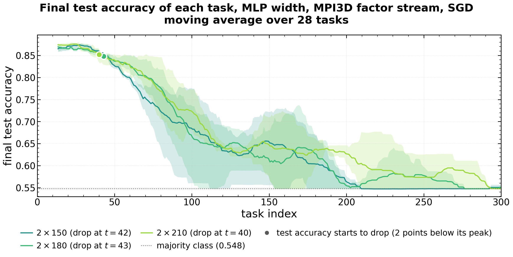

# 07 — MPI3D-realistic factor streams and width sweep (robot-arm images)

**Status:** complete. mlp_2x30 stream (job 1039890) and the width sweep mlp_2x60 … mlp_2x210 (jobs 1067218–1067223, launched 2026-10-19, seeds 0–2, 800 tasks) finished. **Data:** the streams are **packed as one tar per width** in `$HPCVAULT/plasticity_results/mpi3d_realistic_factor_stream_mlp_2x<w>.tar` (1.9–4.8 GB each, verified with `tar -d` before the local copies were deleted); single-task baselines unpacked in `$HPCVAULT/plasticity_results/mpi3d_realistic_factor_single_mlp_2x{30,120}/`; the prepared 480k-image 64×64 dataset in `$WORK/plasticity_data/mpi3d_realistic/` (18 GB) and `plasticity/data/_cache/mpi3d_realistic/prepared_64px` (5.9 GB, read by GPU jobs). Isaac3D was never prepared (`$WORK/isaac3d_raw/` is empty).

## 1. Research question
Does the Shapes3D result (feature-switch streams collapse; width only postpones it, file 02) hold on a different, more realistic factor dataset?

## 2. Setup
MPI3D-realistic (robot arm; seven factors), parity label of factor (t mod 7), mlp_2xW, plain SGD, the same per-task budget as the finished mlp_2x30 run, 800 tasks, checkpoints kept only every 10th task (`--keep_checkpoints_every 10`, added because full checkpointing needed ~207 GB / 115K files). Solvability first: `launch_robot3d_single.sh` (each factor alone), then streams via `launch_robot3d.sh`.

## 3. Results
- **Fresh single-task networks solve the factors:** mean test accuracy 0.925 (mlp_2x30) and 0.938 (mlp_2x120) over 7 factors × 3 seeds. Even single tasks leave some units dead (mean 3.6 / 2.8 of 30 at width 30; 14.1 / 7.6 of 120 at width 120, first / second layer).
- **The streams collapse:** mlp_2x30 falls to ~0.55 test accuracy by task ~100 (fresh ~0.93). At widths 60–210 every run is at the constant-predictor level (~0.533) by task ~200, with the first layer almost entirely dead (status recorded 2026-10-19 at ~325/800 tasks; prior-session note).

## 4. References
- Figures: [`figures/07_mpi3d_alive_units_layer1.png`](figures/07_mpi3d_alive_units_layer1.png)
- Single-task numbers: [`csv/stream_groups.csv`](csv/stream_groups.csv) (`mpi3d_realistic_factor_single_*`)
- Data preparation: `python -m data.robot3d prepare mpi3d_realistic`; launchers `launch_robot3d_single.sh`, `launch_robot3d.sh`
- Prior-session notes: "project_mpi3d_width_sweep", "project_cluster_storage_visibility"

## 5. Conclusions
The collapse reproduces on a second factor dataset and, unlike Shapes3D, width up to 210 does not visibly postpone it on this budget (all widths at chance by task ~200). Both factor datasets share a large common input component, as Shapes3D does (file 05).

## 6. Next steps proposed
- *(Proposed here)* Extract only the per-task `summary.json` files from the tars (`tar -xf … --wildcards '*/summary.json'`) into a small directory, so the collapse task per width can be computed as for Shapes3D (file 02 E2) without unpacking 22 GB.
- *(Proposed here)* Run the centring arm (file 05 E1) on MPI3D: a second dataset where the shared-push explanation can be tested.
- *(From the evidence audit)* Avoid adding more robot datasets unless the two main image families already support the claim.
