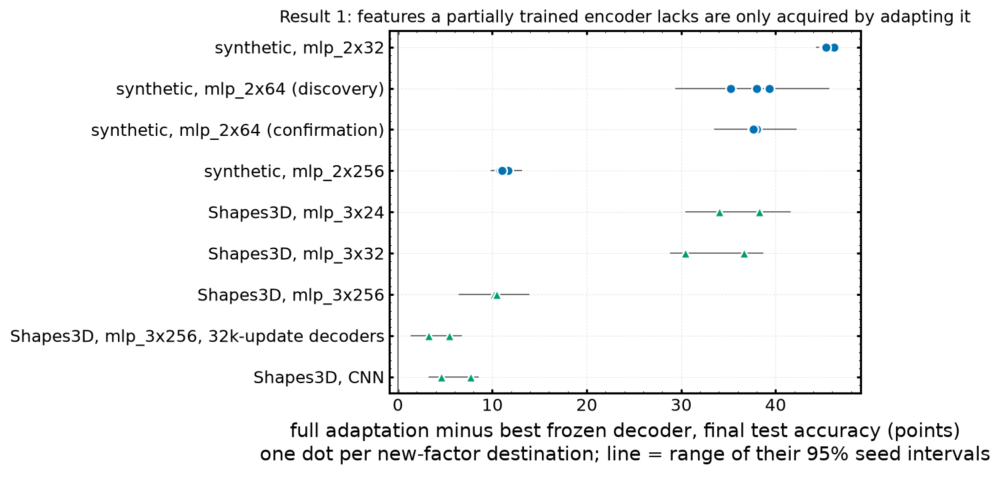

# 08 — Result 1: output remapping vs learning through a fixed representation vs encoder adaptation

**Status:** discovery runs complete (2026-10-31); synthetic **confirmation complete** (2026-11-01, seeds 100–111, learning rates locked from discovery); Shapes3D long-decoder control and narrow-width runs complete; **Shapes3D confirmation not yet launched.** **Data:** `$HPCVAULT/plasticity_results/feature_acquisition/` (moved off `$HOME` on 2026-11-03; `plasticity/results/feature_acquisition` is now a symlink to it). Each run directory has an `interpretation.md` written by the analysis script.

## 1. Research question
When a trained network meets a new task, which of three regimes is it in?
1. **Output remapping:** the information is already in the output layer; only the readout needs changing (e.g. the complement of a known label).
2. **Learning through a fixed representation:** the information is in the hidden features, and a new decoder on frozen features suffices (e.g. XOR of two known factors).
3. **Encoder adaptation:** the features lack the information, and only adapting the encoder acquires it (a factor the encoder was never trained on).

The assay must tell these apart reliably before it can be used to measure how a history changes acquisition (Result 2, file 09).

## 2. Setup
- **Sources:** encoders pretrained either on all factors (`complete`) or on some (`partial`: the remaining heads exist but are never trained). Synthetic data (mlp_2x32 / 2x64 / 2x256, 4,000 source updates) and Shapes3D (mlp_3x24 / 3x32 / 3x256 and a CNN, 3,120 source updates).
- **Destinations:** `complement` (relabel a known factor), `xor` of two known factors, and **new factors** (synthetic f4–f6; Shapes3D object size and shape).
- **Branches:** frozen linear and nonlinear (MLP) decoders up to 8,000 updates (32,000 in the long-decoder control); full adaptation (all weights) for 2,000 updates (continued to 8,000) at a common or retuned lr; a fresh network from the same init. Calibration controls check that available information decodes (> 95%) and absent information stays at chance. Plain SGD, momentum 0, batch 256.
- **Deviation from the written spec:** the pilot showed the spec's learning-rate and weight-decay grids were binding, so discovery used wider grids (lrs up to 1.0; decoder weight decay up to 1e-2) plus feature-standardisation and wide-decoder sensitivity checks.

## 3. Results
Calibration passes in every run.

| regime | destination (synthetic, mlp_2x64) | outcome |
|---|---|---|
| output remapping | complement | frozen decoders 97.5% ≈ full adaptation; swapping the source head's two logits is exact |
| fixed representation | XOR of f1, f2 | frozen nonlinear decoder **93.9%** (linear 59%); full adaptation 2.2 points lower at its tuned lr; **fresh networks 50.5%** — they never learn XOR at any lr |
| encoder adaptation | new factors f4–f6, partial source | frozen decoders 56–61% vs full adaptation 95.8% = fresh: gap **+37.6 to +38.0** points; with the complete source, frozen decoders solve them |

The synthetic confirmation (12 new seeds, locked lrs) replicates discovery.

Gap = full adaptation minus best frozen decoder on new factors, partial source:

| encoder | gap (points) |
|---|---|
| synthetic mlp_2x32 | +45.2 to +46.2 (frozen at chance) |
| synthetic mlp_2x64 | +35.3 to +39.4 (discovery), +37.6 to +38.0 (confirmation) |
| synthetic mlp_2x256 | +10.8 to +11.7 (frozen nonlinear reaches 82%) |
| Shapes3D mlp_3x24 / 3x32 | +34.0 / +38.3 and +30.4 / +36.6 (frozen 62–70%) |
| Shapes3D mlp_3x256, 8k-update decoders | +10.5 (size), +10.2 (shape) |
| Shapes3D mlp_3x256, 32k-update decoders | **+5.4** (size, frozen 94.6%), **+3.3** (shape, 96.7%), still improving |
| Shapes3D CNN | +7.7 (size), +4.6 (shape) |

- On Shapes3D, complement and hue-XOR destinations are solved at 100% by every branch including frozen linear decoders, so the "fixed-representation, nonlinear" regime has no clean Shapes3D instance.
- Wider decoders and feature standardisation never close the synthetic gap.

*Made for this summary from each run's `comparisons.csv` (data: [`csv/feature_acquisition_gaps.csv`](csv/feature_acquisition_gaps.csv)).*

## 4. References
- Per-run interpretations: `$HPCVAULT/plasticity_results/feature_acquisition/*/interpretation.md`; comparisons copied to [`csv/feature_acquisition/`](csv/feature_acquisition/)
- Figures: [`figures/08_synthetic_confirmation_full_minus_frozen.png`](figures/08_synthetic_confirmation_full_minus_frozen.png), [`figures/08_synthetic_confirmation_acquisition_curves.png`](figures/08_synthetic_confirmation_acquisition_curves.png), [`figures/08_synthetic_confirmation_final_accuracy.png`](figures/08_synthetic_confirmation_final_accuracy.png), [`figures/08_shapes3d_longdec_full_minus_frozen.png`](figures/08_shapes3d_longdec_full_minus_frozen.png), [`figures/08_shapes3d_longdec_final_accuracy.png`](figures/08_shapes3d_longdec_final_accuracy.png)
- Source encoders (init / partial / complete): synthetic seed 100 and Shapes3D mlp_3x256 seed 0 in [`checkpoints/feature_acquisition/`](checkpoints/feature_acquisition/)
- Code: `experiments/run_feature_acquisition.py` (presets `synthetic_pilot/_discovery/_confirmation/_width32/_width256`, `shapes3d_mlp/_mlp_confirmation/_cnn`), `data/feature_acquisition.py`, `visualization_scripts/feature_acquisition.py`, `launch_scripts/submit_feature_acquisition.sh`, `tests/test_feature_acquisition.py`
- Prior-session note: "project_result1_feature_acquisition" (jobs 1187081, 1188080–86, 1190383–86)

## 5. Conclusions
- The assay separates the three regimes cleanly on synthetic data and the separation replicates on untouched seeds.
- On images, the encoder-adaptation regime appears clearly with narrow encoders (gap 30–38 points at widths 24–32). At width 256 most of the gap is decoder budget: with 4× longer decoders it shrinks to 3–5 points and is still closing.

## 6. Next steps proposed
- *(From the notes)* Launch the Shapes3D confirmation (`PRESET=shapes3d_mlp_confirmation LOCK_FROM=<discovery dir>`, same grids and sensitivity flags; `load_lock` now refuses mismatched grids). It was waiting for the long-decoder result, which is in.
- *(Proposed here)* Run it on narrow encoders (3x24 / 3x32), where the regime is unambiguous, rather than at 3x256.
- *(Proposed here)* Several lr selections sit at the edge of the grid (32 of 240 frozen-decoder selections in the synthetic confirmation; 59 of 96 in the Shapes3D long-decoder run), so a wider grid could still move those comparisons.
- **Storage note:** confirmation presets read their discovery directory (`--lock_from`), which is now on `$HPCVAULT` and invisible to GPU nodes. Copy the discovery run back to `$HOME` (or `/hnvme`) before launching.
