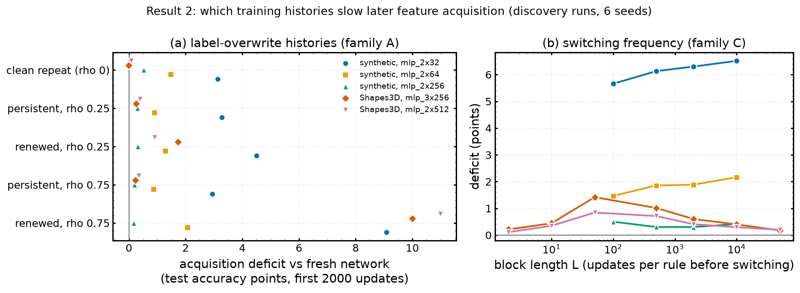

# 09 — Result 2: which training histories slow later feature acquisition

**Status:** all five discovery runs complete (2026-11-02, seeds 0–5); **confirmations (seeds 100–111) not launched**, deliberately held until discovery and calibration are reviewed. **Data:** `$HPCVAULT/plasticity_results/history_acquisition/` (moved off `$HOME` on 2026-11-03; `plasticity/results/history_acquisition` is now a symlink). Each run has `analysis/main-*/report.md` (copied to [`csv/history_acquisition/`](csv/history_acquisition/)).

## 1. Research question
Starting from random initialisation (no pretraining), which properties of a training history change how well the network later acquires a *new* feature? Three controlled families:
- **A — overwrite fraction ρ:** train on factor f1 while a fraction ρ of labels is corrupted, either **persistently** (the same corrupted labels throughout) or **renewed** (re-drawn every block of L updates).
- **B — rule type / magnitude:** alternate f1 with its complement, with a second factor f2, with rotations of f1's direction (synthetic) or hue shifts (Shapes3D); `repeat` = f1 alone.
- **C — switching frequency:** alternate two rules with block length L, with per-rule exposure matched exactly.

## 2. Setup
- Histories of T = 40,000 updates (synthetic, lr 0.03) or 400,000 (Shapes3D), checkpoints at ages 0, T/2, T. Synthetic mlp_2x32 / 2x64 / 2x256; Shapes3D mlp_3x256 and mlp_2x512.
- Acquisition assay at each checkpoint, on new factors (synthetic f4–f6; Shapes3D size and shape): full adaptation, frozen linear / nonlinear decoders, and a fresh network = the same seed's saved initialisation.
- **Deficit** = fresh minus checkpoint test accuracy, averaged over the first 2,000 updates (positive = worse than fresh); also at 8,000 updates. Shared acquisition lr selected on fresh validation, pooled over seeds. 17 synthetic conditions deduplicate into 12 unique histories.
- Calibration: synthetic f1/f2 reach 90% train accuracy in 300–500 updates (the block-length grid 100–10,000 brackets it); Shapes3D hue rules in 1–16 updates, so its grid was extended down to L = 2, 10, 50 and fixed as the default.

## 3. Results
Deficit (test-accuracy points, first 2,000 updates, oldest checkpoint, 6 seeds):

| condition | syn 2x32 | syn 2x64 | syn 2x256 | S3D 3x256 | S3D 2x512 |
|---|---|---|---|---|---|
| clean repeat (ρ = 0) | +3.1 | +1.5 | +0.5 | −0.0 | +0.1 |
| persistent, ρ = 0.75 | +2.9 | +0.9 | +0.2 | +0.2 | +0.3 |
| renewed, ρ = 0.25 | +4.5 | +1.3 | +0.3 | +1.7 | +0.9 |
| **renewed, ρ = 0.75** | **+9.1** | **+2.1** | +0.2 | **+10.0** | **+11.0** |
| B: complement | +7.3 | +2.3 | +0.2 | +0.5 | +0.4 |
| B: second factor f2 | +6.3 | +1.9 | +0.3 | – | – |
| B: rotations 0.125π / 0.25π | +3.6 / +3.8 | +1.4 / +1.3 | +0.6 / +0.3 | – | – |

- Every history is at least slightly worse than fresh.
- **Renewed heavy label noise (ρ = 0.75) is the most harmful history** in four of five runs (the frozen decoder collapses to 56% on Shapes3D 3x256). **The same noise held persistent is harmless** (≈ clean repeat): what hurts is relearning noise, not having seen it.
- **Deficits shrink with width:** synthetic 2x32 > 2x64 > 2x256 ≈ 0.
- **Rule type (2x32):** complement +7.3 ≈ second factor +6.3 > rotations +3.6 / +3.8 ≈ repeat +3.1, which is not monotone in how much the rules disagree.
- **Switching frequency:** on Shapes3D an inverted U, peaking at L = 50 (3x256: +0.2 at L = 2, +0.4 at 10, **+1.4 at 50**, +1.0 at 500, +0.2 at 50,000; replicated at 2x512 with a peak of +0.8); on synthetic data roughly flat.
- **All deficits roughly halve by 8,000 updates** (median ratio 0.48; Shapes3D renewed ρ = 0.75: 10.0 → 2.6): mostly a finite-budget acquisition slowdown, not a permanent inability.

*Made for this summary from each run's `acquisition_stats.csv` (data: [`csv/history_acquisition_deficits.csv`](csv/history_acquisition_deficits.csv), with deficits at 2,000 and 8,000 updates).*

## 4. References
- Reports and contrasts: [`csv/history_acquisition/`](csv/history_acquisition/)
- Figures from the runs: [`figures/09_synthetic_w32_deficit_vs_corruption.png`](figures/09_synthetic_w32_deficit_vs_corruption.png), [`figures/09_synthetic_w32_deficit_vs_rule.png`](figures/09_synthetic_w32_deficit_vs_rule.png), [`figures/09_synthetic_w32_deficit_vs_block_length.png`](figures/09_synthetic_w32_deficit_vs_block_length.png), [`figures/09_synthetic_w32_frozen_vs_full.png`](figures/09_synthetic_w32_frozen_vs_full.png), [`figures/09_shapes3d_3x256_deficit_vs_block_length.png`](figures/09_shapes3d_3x256_deficit_vs_block_length.png), [`figures/09_shapes3d_3x256_deficit_vs_corruption.png`](figures/09_shapes3d_3x256_deficit_vs_corruption.png)
- Checkpoints: init, renewed ρ = 0.75 and persistent ρ = 0.75 at the oldest age, seed 0, for synthetic 2x32 and Shapes3D 3x256, in [`checkpoints/history_acquisition/`](checkpoints/history_acquisition/)
- Code: package `plasticity/history_acquisition/` (config, data, workspace, history, probe, summary, run), `visualization_scripts/history_acquisition.py`, `tests/test_history_acquisition.py`, `launch_scripts/submit_history_acquisition.sh`; jobs 1191300–1191311 (+ reruns 1193693/1193695)
- Prior-session note: "project_result2_history_acquisition"
- Bugs fixed during the runs: parallel array tasks raced on `manifest.json.tmp` (seed 0 of two runs rerun); current-task metrics at block-boundary ages used the next block's rule (now read from checkpoints)

## 5. Conclusions
- The clearest history effect is **renewed label noise at high ρ**, consistent across synthetic and Shapes3D at moderate and large widths, and absent when the same noise is persistent.
- The effects are budget-limited slowdowns that halve by 8,000 updates and fade with width — modest compared with the stream collapses of files 02–07.

## 6. Next steps proposed
- *(From the notes)* Launch confirmations (seeds 100–111) with the acquisition lr locked from discovery (`--acq_lr_from`); `DRY_RUN=1` first; a grid of acquisition lrs needs the probe stage in one non-array job.
- *(Proposed here)* Prioritise the renewed-vs-persistent ρ = 0.75 contrast at widths 32 and 3x256, where it is large, and add ρ = 0.5 to see whether the effect is a threshold or graded.
- **Storage note:** the confirmations read the discovery runs, now on `$HPCVAULT` and invisible to GPU nodes; copy them back to `$HOME` (≈ 6 GB each) before launching.
