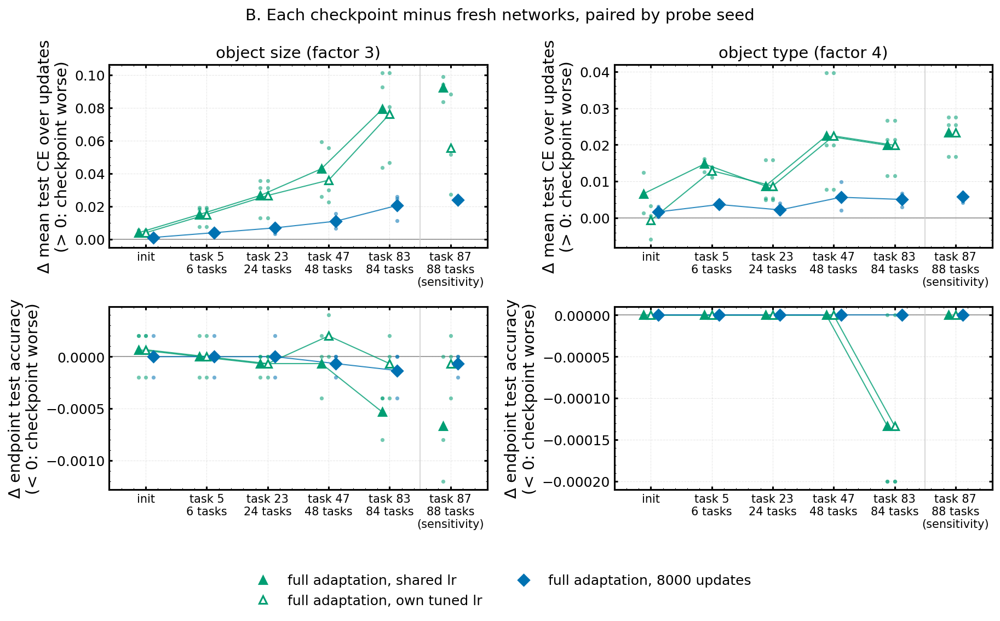

# 10 — Checkpoint-acquisition pilot: do aged stream checkpoints learn new factors worse than fresh ones?

**Status:** pilot complete (job 1186522, 2026-10-30, one history, 3 probe seeds). **Data:** `$HPCVAULT/plasticity_results/checkpoint_acquisition/shapes3d_cluster_stream_ep100_subset__…__pilot-71770d79cfe9/` (moved off `$HOME` on 2026-11-03; `interpretation.md` inside). The spec called for the 40-epoch Shapes3D cluster stream, which is on the Mac; by the user's choice the pilot ran on the **100-epoch** run instead (tasks 0–87 copied to `plasticity/results/shapes3d_cluster_stream_ep100_subset/`).

## 1. Research question
Take checkpoints of one real stream at increasing ages. Does an older checkpoint learn a held-out factor (one the stream never used as a label) worse than a younger one, and is that because the information is missing from its features or because adaptation is slower?

## 2. Setup
- History: Shapes3D cluster-factor stream, mlp_2x30, seed 0, 100 epochs per task; checkpoints at init and tasks 5, 23, 47, 83, 87.
- Destinations: the **true** Shapes3D factors object size (factor 3) and object type (factor 4) — not the cluster factors the stream trained on.
- Branches: full adaptation and fresh networks (2,000 updates, lr grid 0.001–0.1, continued to 8,000); frozen decoders (linear and MLP, 8,000 updates, lr and weight-decay grids). Adaptation 8,192 images, validation 2,048, test 5,000. A difference counts only if every probe seed exceeds a fixed margin (1 point / 0.01 nats) in the same direction.

## 3. Results
- **Full adaptation reaches ~100% test accuracy on size and type at every age.**
- **The best tuned frozen decoder gets worse with age:** 0.82 → 0.63 (size) and 0.83 → 0.63 (type) from task 5 to task 83, while first-layer dead units go from 0 to 20 of 30. At every checkpoint full adaptation beats the best frozen decoder by more than the margin for every seed.
- **Age slows acquisition of size only:** task 83 learns it worse than task 5 under full adaptation (mean test cross-entropy over 2,000 updates +0.064 nats [+0.024, +0.094]; robust to retuning the lr per checkpoint), but after 8,000 updates the endpoint difference is within the margin. On type there is no consistent age effect.

## 4. References
- [`csv/checkpoint_acquisition_summary.csv`](csv/checkpoint_acquisition_summary.csv), [`csv/checkpoint_acquisition_comparisons.csv`](csv/checkpoint_acquisition_comparisons.csv)
- Figures: [`figures/10_pilot_frozen_vs_full.png`](figures/10_pilot_frozen_vs_full.png), [`figures/10_pilot_curves_extended.png`](figures/10_pilot_curves_extended.png), [`figures/10_pilot_late_minus_early.png`](figures/10_pilot_late_minus_early.png)
- Aged checkpoints probed (init, tasks 5/23/47/83/87): [`checkpoints/checkpoint_acquisition/`](checkpoints/checkpoint_acquisition/)
- Code: `experiments/run_checkpoint_acquisition.py`, `visualization_scripts/checkpoint_acquisition.py`, `launch_scripts/submit_checkpoint_acquisition.sh`; shared helpers `utils/acquisition_probe.py`
- Prior-session note: "project_checkpoint_acquisition_pilot"

## 5. Conclusions
On this one history, age removes linearly/MLP-decodable information about held-out factors from the frozen features, but full adaptation recovers it completely; the only acquisition cost is a modest, transient slowdown on one of two factors. A slower acquisition, not a persistent deficit, at this budget.

## 6. Next steps proposed
- *(From the notes)* Sync the 40-epoch run from the Mac to `$HOME` or `/hnvme` and run the pilot the spec describes.
- *(From the publication-strategy report)* Turn the pilot into the paired checkpoint experiment: branch identical aged checkpoints into historical pool / fresh pool / refreshed samples / duplicated old points, with held-out tasks matched for fresh difficulty, and report the integrated acquisition deficit D_C against fresh initialisation.
- *(Proposed here)* Use more than one history and several seeds per age before reading the age trend.
